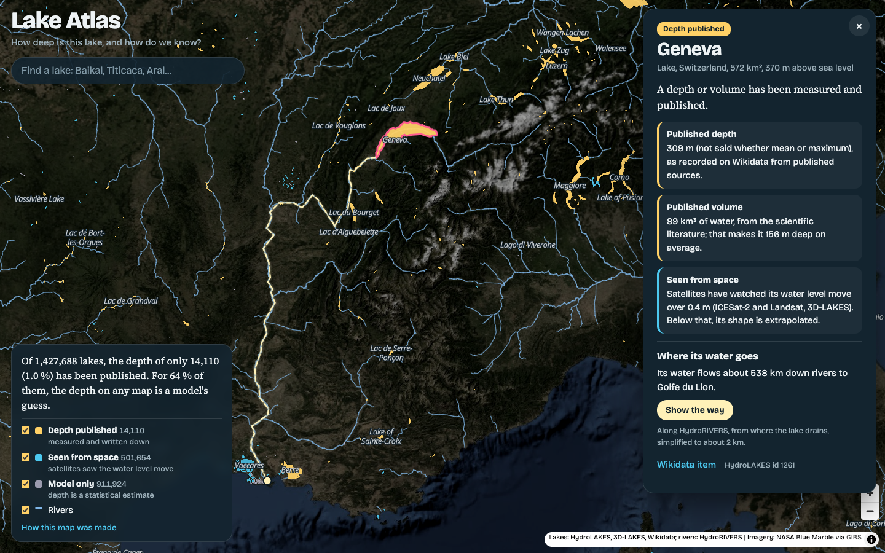
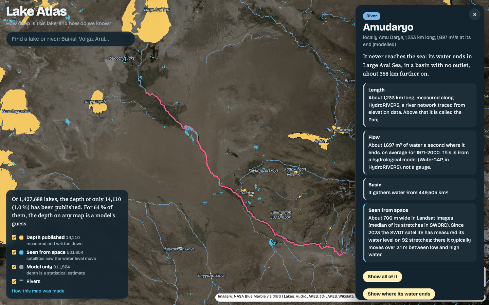
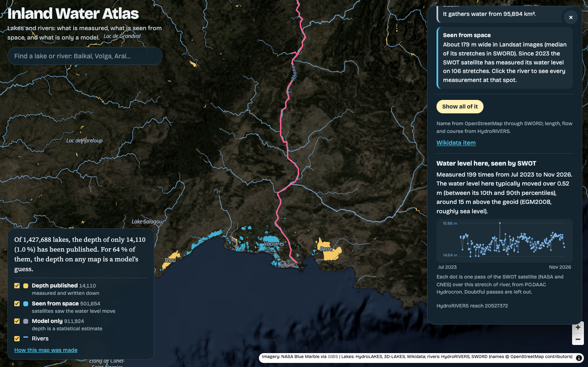

# Inland Water Atlas

**The world's lakes and rivers: what is measured, what is seen from space, and what is only a model.**
All 1,427,688 lakes of at least 10 hectares and the rivers between them on one map, at
[inlandwater.bristleconelab.org](https://inlandwater.bristleconelab.org). Lakes are coloured by the best evidence there
is for their depth.

| | Lakes | Share |
|---|---:|---:|
| **Depth published**: a measured depth or volume, from the literature, a dam register or Wikidata | 14,110 | 1.0 % |
| **Seen from space**: satellites saw the water level rise and fall over part of the bed (3D-LAKES) | 501,654 | 35.1 % |
| **Model only**: the depth in HydroLAKES, and in the maps and models built on it, is a statistical estimate | 911,924 | 63.9 % |

By area the picture is better: lakes with a published depth cover 57.8 % of all lake area, because the big lakes are
the well-studied ones. Satellites typically saw a band of water level only 0.66 m high.

Click any lake to read what is known: its published depth (with a link to the Wikidata item), a volume from the
literature or a dam register, the band of level satellites have seen, or the model estimate. When a published depth
does not fit the published volume, the panel says so. Search 125,598 named lakes and 6,746 named rivers by name;
rivers with at least 5 m³/s of average flow are drawn underneath, and 6,980 of them carry their name on the map.

The panel also answers two more questions:

- **Where does its water go?** For 233,338 lakes (every lake of at least 1 km², every named lake and every lake with a
  water record), the river path from the lake's outlet to the sea, drawn on the map with *Show the way*. 222,535 reach
  a named sea; 8,597 end inland, in a basin with no outlet (named after the lake they end in, such as the Aral Sea);
  for 2,206 the river map stops without reaching a sea, and the panel says so.
- **How has its water changed?** For 20,807 lakes and reservoirs, the yearly water volume from 1984 to 2025 on a scale
  from zero, with one sentence comparing the first five years with the last five, and the trend over the whole record:
  the Theil-Sen slope as a share of the lake's usual volume a decade with its 95 % interval, and a Mann-Kendall test
  corrected for year-to-year carry-over (Hamed and Rao 1998), drawn as a dashed line. Lakes that fill in wet years and
  dry out in between are described as such instead of being given a trend.
- **Where does its water come from?** For every lake of at least 10 km² and every named river, its catchment drawn on
  the map (HydroBASINS level-8 units upstream of its outlet), its area and the lakes in it.
- **How has the level of the largest lakes changed?** For 457 lakes that radar altimeters follow (the Caspian,
  Baikal, Victoria, the Great Lakes, which GloLakes leaves out), the yearly water level since 1992 with its trend in
  centimetres a decade. The Caspian fell by about 2 m between 1992 and 2025.
- **What shape is its bed?** For every lake, the area against depth from GLOBathy's model (dashed), with the levels
  satellites traced (3D-LAKES) as dots, and how far the model's maximum depth is from a published one.

**How wrong is the model?** A map view colours the 926 lakes whose maximum depth is published on Wikidata (with the
criterion "maximum") and was not itself used by GLOBathy (44 more were: there the two agree by construction) by
how far GLOBathy's model maximum is from it. The model is within a factor of two for 59 % of these lakes and
within a quarter for 20 %; it makes lakes under 1 km² 1.38 times too deep on the median, and lakes of
100 km² and more 1.37 times.

Two tools sit under the colour key: **Compare** puts the water of up to four lakes on one chart, each against its own
usual volume; **Show the numbers** adds every value of a lake or river with its source, and CSV downloads (the
numbers, water by year, the bed shape, every SWOT pass).

Click a river to see the same kind of answer for it:

- **What it is**: its name (and local name), its length from its farthest source, its average flow where it ends and the
  area it drains, with the whole river drawn on the map and a link to its Wikidata item where one was found (3,487).
- **Where it goes**: the river it flows into, and the sea or inland basin its water reaches (*Show the way to the sea*).
- **What satellites have seen**: its width in Landsat images, and on how many stretches the SWOT satellite has measured
  its level since 2023 (5,443 rivers). At the spot you click, the panel asks NASA's Hydrocron service for that stretch's
  SWOT measurements and draws every good pass since July 2023, with its height scale and the date and height of each
  pass on hover.


| Finland: well documented | Northern Canada: mostly seen from space or modelled |
|---|---|
|  |  |

| Geneva: its water reaches the Mediterranean through the Rhône | Narran: a lake that fills only in wet years |
|---|---|
|  |  |

| Amu Darya: named, measured by SWOT, ending in the Aral Sea | Rhône: water level at Avignon, seen by SWOT |
|---|---|
|  |  |

| The whole Earth | On a phone |
|---|---|
|  |  |

## Why

Lake depth drives estimates of the world's fresh water, lake heat and ice, methane and carbon, and lake models inside
weather forecasts. The global datasets (HydroLAKES, GLOBathy, GLRDAV) estimate it for every lake, but none of them, and
no viewer, shows which depths were actually measured. GLOBathy, GLRDAV/Global Waterbody Calculator and 3D-LAKES are
data and code; the Global Surface Water Explorer shows water extent, not depth.

## Data

| Data | Source | Licence |
|---|---|---|
| Lake outlines, area, volume and depth, volume source | [HydroLAKES v1.0](https://www.hydrosheds.org/products/hydrolakes), Messager et al. (2016) | CC BY 4.0 |
| Modelled depth, mean depth and area-depth curve of every lake | [GLOBathy](https://doi.org/10.6084/m9.figshare.13402070), Khazaei et al. (2022) Scientific Data | CC0 |
| Catchment outlines | [HydroBASINS v1c](https://www.hydrosheds.org/products/hydrobasins) level 8, Lehner and Grill (2013) | CC BY 4.0 |
| Water level of the largest lakes since 1992 (radar altimetry) | [NASA GSFC Global Water Monitor](https://earth.gsfc.nasa.gov/gwm/lake/Index), formerly USDA G-REALM | US Government work |
| Water-level band seen by ICESat-2 and Landsat (L1) | [3D-LAKES](https://doi.org/10.5281/zenodo.13107867), Huang et al. (2025) Scientific Data | CC BY 4.0 |
| Names (125,598 lakes) and published depths (7,616 lakes) | [Wikidata](https://www.wikidata.org) via [QLever](https://qlever.dev), matched when the item's point is inside the lake | CC0 |
| Rivers, flow at least 5 m³/s; downstream paths | [HydroRIVERS v1.0](https://www.hydrosheds.org/products/hydrorivers), Lehner and Grill (2013) | CC BY 4.0 |
| Water volume by month since 1984 (22,367 lakes) | [GloLakes v1.1](https://doi.org/10.25914/K8ZF-6G46), Hou et al. (2024) Earth System Science Data 16, 201 | CC BY 4.0 |
| Names of seas where rivers end | [Natural Earth](https://www.naturalearthdata.com) 1:10m marine areas (river mouths and estuaries take the sea they open into) | public domain |
| River names, widths, which stretches SWOT has measured | [SWORD v17c](https://doi.org/10.5281/zenodo.23870877), the SWOT River Database (Altenau et al. 2021); names from [OpenStreetMap](https://www.openstreetmap.org/copyright) | CC BY 4.0 (names © OpenStreetMap contributors, ODbL) |
| River water level at a point, every SWOT pass | [PO.DAAC Hydrocron](https://podaac.github.io/hydrocron/), SWOT L2 HR River Single Pass (NASA/CNES), fetched live | open (NASA Earthdata) |
| River translations and items | [Wikidata](https://www.wikidata.org) via [QLever](https://qlever.dev): rivers with articles in at least 5 languages | CC0 |
| Background | NASA Blue Marble through GIBS | public domain |

## How it is built

Every formula and filter is in [docs/method.md](docs/method.md); what was checked, against what, is in
[docs/validation.md](docs/validation.md) (river lengths against Wikidata, the depth model against published maxima, the
trend statistics against scipy, reproducibility).


The pipeline runs on a Linux server (`pipeline/`): `build_lakes.py` joins HydroLAKES, 3D-LAKES and Wikidata and writes
`out/stats.json`; `build_rivers.py` names the rivers; `build_tiles.sh` makes vector tiles with
[tippecanoe](https://github.com/felt/tippecanoe) (lakes, labels, rivers, river names); `split_pmtiles.mjs` cuts them
into pieces of 2 MiB for a static host without range requests; `build_search.py` and `build_search_rivers.py` write the
name indexes (with the country of each lake, so the 33 lakes called Victoria can be told apart). The tile pieces are
published as their own static site and read with `src/chunked.ts`.

`build_flow.py` adds the river paths and water records. A lake joins HydroRIVERS at the reach nearest to its HydroLAKES
pour point (within about 2 km); its path follows `NEXT_DOWN` to the outlet and is simplified to about 2 km, and its
length is the reach's `DIST_DN_KM`. An outlet within 2.5 degrees of a Natural Earth marine area is a river mouth
(big estuaries such as the Yenisey's end more than a degree short of the gulf polygon); farther away, it is not, and
the panel says the river map stops there. Natural Earth also draws estuaries as marine areas ("Saint Lawrence River",
"Amazon River", "Canal do Sul"); such an area takes the name of the real sea it opens into (`pipeline/seas.py`), so
the Great Lakes reach the Gulf of Saint Lawrence and not "the Saint Lawrence River". GloLakes is reduced to one value
a year without the seasons: each month minus the lake's mean for that calendar month, the median for the year, plus
the lake's median (years with at least three months; lakes with at least five such years). A plain median of the
cloud-free months makes a summer-only year look fuller or emptier than it was. Negative storage values are dropped,
and so is 2026, which the record covers only to November. Both are written as 128 JSON files per kind, so a lake's
panel loads at most one 640 kB file per question (about 150 kB compressed).

Wikidata coordinates arrive as `POINT(lon lat)` for Earth; points on other bodies (Mars has lakes on Wikidata) carry a
globe prefix and are skipped. Depths are read with their unit normalised to metres, and "mean" and "maximum" are told
apart from the "criterion used" qualifier where it is given. Deprecated statements are left out, a preferred one wins
where there is one, and several values of one kind give their median (never the largest, which is often a typo or a
dam height). The panel says when a depth cites no source, and flags a published depth more than four times the mean
depth a published volume implies (most lakes are 1.5 to 4 times deeper at their deepest point than on average).

`build_rivers.py` names the rivers. HydroRIVERS has a network but no names; SWORD has names (from OpenStreetMap) for
rivers about 30 m wide or more. Each HydroRIVERS reach of at least 5 m³/s is matched at three points to the nearest SWORD
reach within about 1.5 km whose drainage area agrees within a factor of three, and takes the name most points agree
on. Names are compared without case, accents or words like "River" and "Rio". Spellings of one river are joined when
SWORD often gives them to the same reach, when they follow each other downstream and nearly match ("Amudarya",
"Amudaryo"), or when both are labels of the same Wikidata river ("Donau", "Danube"). A reach takes the name of the
river below it when that name also continues up one of its branches (a confluence reach named after the tributary), a
stretch between two parts of one river joins it (the Ob's "Sharap" stretch), nameless gaps such as reservoirs are filled
when the same name continues below, and the name is carried up the biggest branch to the farthest source. Labels use
one merged line per river. Where a river's Wikidata item is found (the best-known river labelled with one of its
spellings within 1.5 degrees), its English label is the name shown and the SWORD name stays searchable (Chang Jiang
is shown as the Yangtze). `build_search_rivers.py` writes the river search index, under the name, the local name and
the former name. The tile archive is rebuilt under a new name for each version (`lakes-atlas-v5/`), because the tile
site lets browsers cache files for a week.

## Honest limits

- A Wikidata depth can be wrong (Titicaca is recorded as 489 m without saying mean or maximum; the literature gives
  about 280 m at the deepest; the panel now flags it) or can belong to a nearby water body. Each lake links to its item
  so it can be checked.
- 3D-LAKES "seen" means the shape of the top of the bed over the range the water level moved; the full depth is still
  extrapolated.
- HydroLAKES outlines date from around 2000 (the Aral Sea is drawn larger than today).
- River paths follow the river network, not the real hydrology of every lake: a terminal lake next to a river (the
  Narran Lakes, say) is drawn as draining into it, and 31,180 of the 264,517 lakes considered are more than about 2 km
  from any mapped river and get no path.
- River names come from OpenStreetMap through SWORD and only for rivers about 30 m wide or more. Some rivers are still
  split or mislabelled (a stretch of the Amazon carries the name of a tributary, Arapiuns), and delta branches are
  named as rivers of their own (the Danube "flows into" the Kiliia branch).
- River lengths are measured along HydroRIVERS from the farthest source the network reaches; they differ from textbook
  lengths, which follow other conventions. River flows are modelled long-term averages (WaterGAP, 1971–2000), not gauge
  readings, and they do not take out what dams and irrigation use: far less reaches the Aral Sea through the Amu Darya
  than the panel's number.
- SWOT water levels are heights above the EGM2008 geoid from single passes. Passes with quality flag 2 or worse, over
  ice, or with an uncertainty over 1 m are dropped, and so are heights both more than 10 median absolute deviations and
  more than 10 m from the rest (a bank or a bridge); real floods of several metres stay in. Some noise remains. SWORD's
  own per-stretch level range is not shown: it includes poor passes (6.7 m for the Rhône, against 0.5 m in the
  filtered passes at Avignon).
- Catchment outlines are made of HydroBASINS level-8 units, a few hundred km² each, so they are rough near the outlet,
  and a big lake with several inflows shows the catchment of the unit at its outlet only (the Caspian's outline is the
  Volga's; its area, 1.4 million km², is HydroLAKES' own and complete).
- GLOBathy is itself a model; for 44 lakes it uses a published maximum depth, and those are left out of the model
  error figures.
- GloLakes leaves out the largest lakes (the Caspian, the Great Lakes, Baikal and others), so they have no water
  record here. Its volumes come mostly from the lake's extent in Landsat images; the year-to-year ups and downs are
  more reliable than the absolute amount.

## Development

```sh
npm install
python3 scripts/tiles_server.py ../lakes-atlas-tiles 5401 & # the tile pieces with CORS (any static server will do)
VITE_TILES=http://127.0.0.1:5401/ npx vite --port 5499
npm test                                                     # depth evidence and checks, search, flow, water and river wording, SWOT filtering
```

Code: MIT. Part of [Bristlecone Lab](https://bristleconelab.org).
