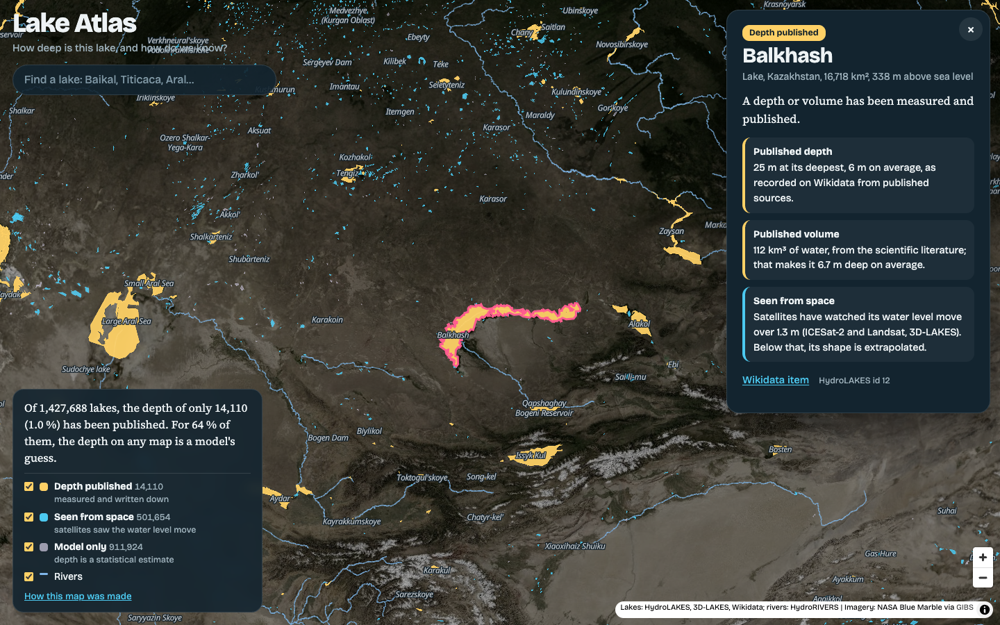
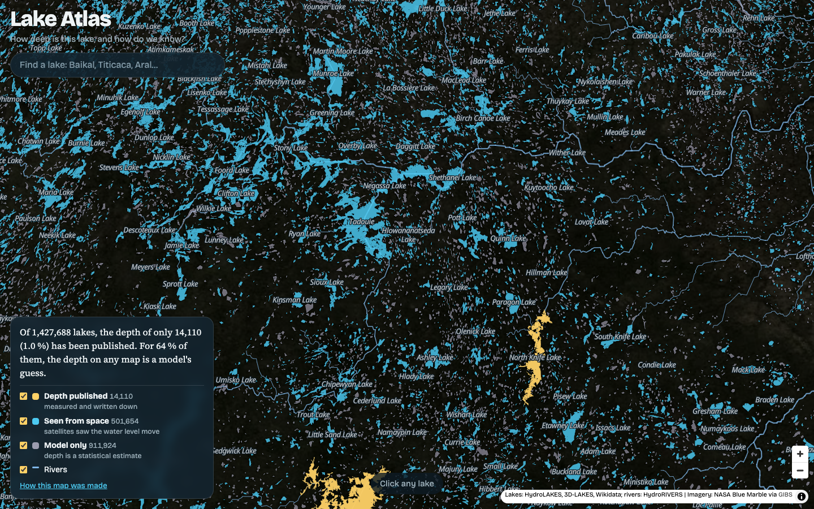
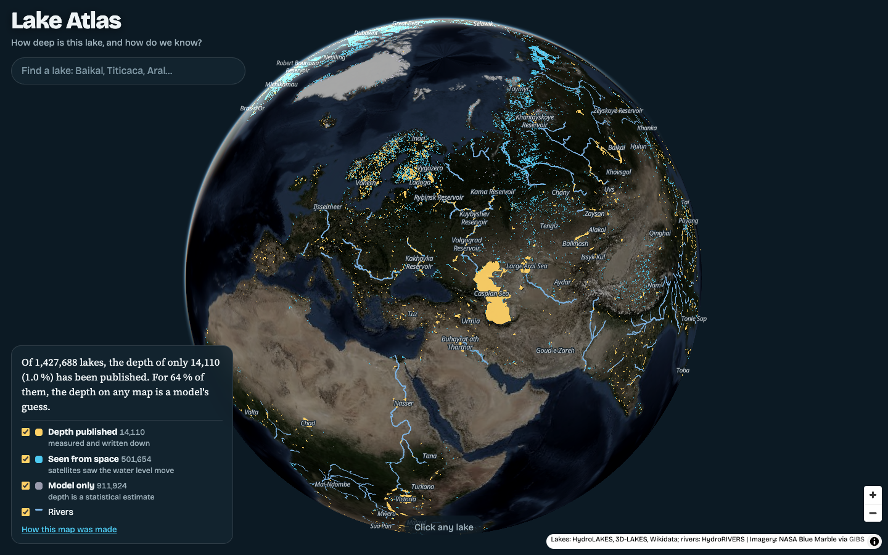
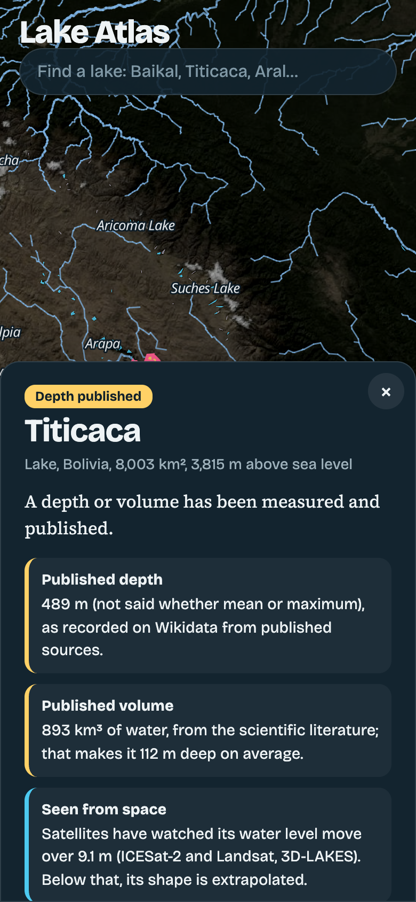

# Lake Atlas

**How deep is this lake, and how do we know?** All 1,427,688 lakes of at least 10 hectares on one map, coloured by
the best evidence there is for their depth.

| | Lakes | Share |
|---|---:|---:|
| **Depth published**: a measured depth or volume, from the literature, a dam register or Wikidata | 14,110 | 1.0 % |
| **Seen from space**: satellites saw the water level rise and fall over part of the bed (3D-LAKES) | 501,654 | 35.1 % |
| **Model only**: the depth in HydroLAKES, and in the maps and models built on it, is a statistical estimate | 911,924 | 63.9 % |

By area the picture is better: lakes with a published depth cover 57.8 % of all lake area, because the big lakes are
the well-studied ones. Satellites typically saw a band of water level only 0.66 m high.

Click any lake to read what is known: its published depth (with a link to the Wikidata item), a volume from the
literature or a dam register, the band of level satellites have seen, or the model estimate. When a published depth
does not fit the published volume, the panel says so. Search 125,597 named lakes by name; rivers with at least 5 m³/s
of average flow are drawn underneath.



| Finland: well documented | Northern Canada: mostly seen from space or modelled |
|---|---|
|  |  |

| The whole Earth | On a phone |
|---|---|
|  |  |

## Why

Lake depth drives estimates of the world's fresh water, lake heat and ice, methane and carbon, and lake models inside
weather forecasts. The global datasets (HydroLAKES, GLOBathy, GLRDAV) estimate it for every lake, but none of them, and
no viewer, shows which depths were actually measured. GLOBathy, GLRDAV/Global Waterbody Calculator and 3D-LAKES are
data and code; the Global Surface Water Explorer shows water extent, not depth.

## Data

| Data | Source | Licence |
|---|---|---|
| Lake outlines, area, volume and depth, volume source | [HydroLAKES v1.0](https://www.hydrosheds.org/products/hydrolakes), Messager et al. (2016) | CC BY 4.0 |
| Water-level band seen by ICESat-2 and Landsat (L1) | [3D-LAKES](https://doi.org/10.5281/zenodo.13107867), Huang et al. (2025) Scientific Data | CC BY 4.0 |
| Names (125,597 lakes) and published depths (7,616 lakes) | [Wikidata](https://www.wikidata.org) via [QLever](https://qlever.dev), matched when the item's point is inside the lake | CC0 |
| Rivers, flow at least 5 m³/s | [HydroRIVERS v1.0](https://www.hydrosheds.org/products/hydrorivers), Lehner and Grill (2013) | CC BY 4.0 |
| Background | NASA Blue Marble through GIBS | public domain |

## How it is built

The pipeline runs on a Linux server (`pipeline/`): `build_lakes.py` joins HydroLAKES, 3D-LAKES and Wikidata and writes
`out/stats.json`; `export_rivers.py` filters HydroRIVERS; `build_tiles.sh` makes vector tiles with
[tippecanoe](https://github.com/felt/tippecanoe) (lakes, labels, rivers; 617 MB of PMTiles); `split_pmtiles.mjs` cuts
them into 294 pieces of 2 MiB for a static host without range requests; `build_search.py` writes the name index.
The tile pieces are published as their own static site and read with `src/chunked.ts`.

Wikidata coordinates arrive as `POINT(lon lat)` for Earth; points on other bodies (Mars has lakes on Wikidata) carry a
globe prefix and are skipped. Depths are read with their unit normalised to metres, and "mean" and "maximum" are told
apart from the "criterion used" qualifier where it is given.

## Honest limits

- A Wikidata depth can be wrong (Titicaca is recorded as 489 m without saying mean or maximum; the literature gives
  about 280 m at the deepest) or can belong to a nearby water body. Each lake links to its item so it can be checked.
- 3D-LAKES "seen" means the shape of the top of the bed over the range the water level moved; the full depth is still
  extrapolated.
- HydroLAKES outlines date from around 2000 (the Aral Sea is drawn larger than today).

## Development

```sh
npm install
python3 scripts/tiles_server.py ../lakes-atlas-tiles 5401 & # the tile pieces with CORS (any static server will do)
VITE_TILES=http://127.0.0.1:5401/ npx vite --port 5499
npm test                                                     # depth evidence wording, consistency check, search
```

Code: MIT. Part of [Bristlecone Lab](https://bristleconelab.org).
