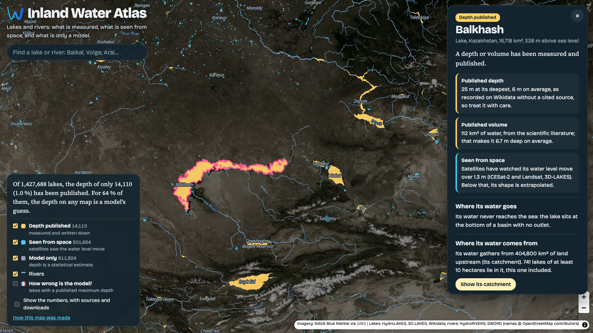
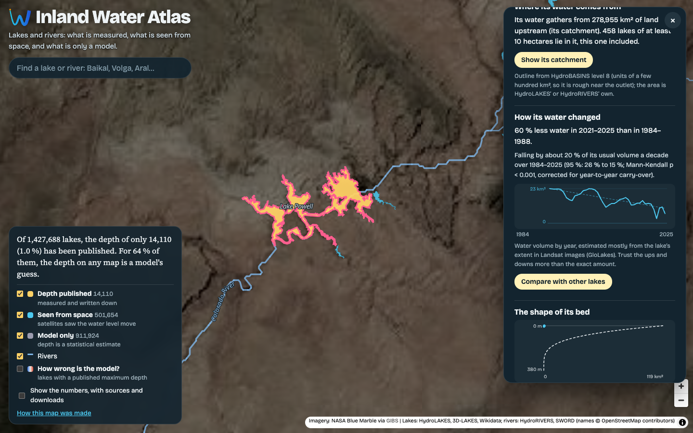
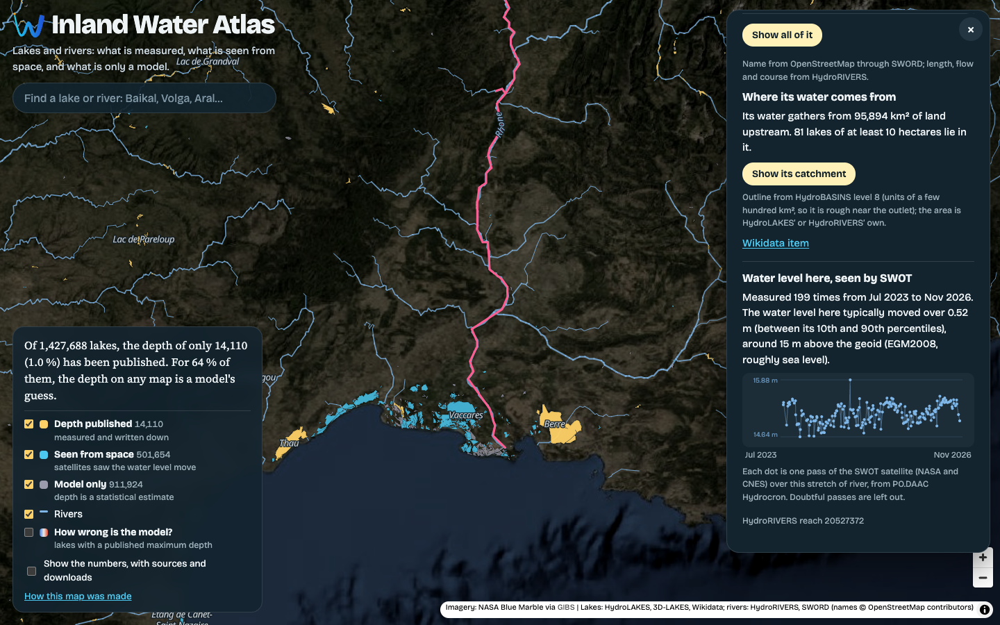

<a href="https://inlandwater.bristleconelab.org">
  <picture>
    <source media="(prefers-color-scheme: dark)" srcset="public/brand/inland-water-atlas-logo-dark.svg">
    
  </picture>
</a>

**How deep is this lake, and how do we know?**

A map of the world's 1.4 million lakes and 7,000 named rivers that shows, for each lake, whether its depth was
measured, seen from space, or only guessed by a model. For two thirds of them, only a model knows.

[**inlandwater.bristleconelab.org**](https://inlandwater.bristleconelab.org)

<a href="https://github.com/bristleconelab"><picture><source media="(prefers-color-scheme: dark)" srcset="public/brand/bristleconelab-mark-light.svg"></picture></a>&nbsp; powered by [**bristlecone lab**](https://github.com/bristleconelab)

- **Click any lake:** its depth and where that number comes from (a measurement, satellites, or a model), with a
  link to check the source.
- **See its water change:** yearly volume since 1984 with a tested trend, and the level of the largest lakes, from the
  Caspian to the Great Lakes, since 1992.
- **Follow the water:** the river path from a lake to the sea, and the land its water gathers from.
- **Click any river:** its name, length and flow, the sea it reaches, its profile from source to end with the lakes and
  reservoirs on it, how much of its yearly flow dams can hold, and every water level the SWOT satellite has measured
  on it since 2023.
- **Colour the map by** how the depth is known, how wrong the depth model is, which lakes are drying or filling,
  natural lakes against reservoirs, or lakes with no way to the sea.
- **More:** residence time and lake-shape numbers, step changes in a lake's water, up to four lakes on one chart,
  search in 24 languages (Orol, Байкал, Chorvoq), every number with its source as CSV.

| Lake Powell: 60 % less water than in the 1980s | The Rhône at Avignon: 199 SWOT passes since 2023 |
|---|---|
|  |  |

Of 1,427,688 lakes, the depth of only 14,110 (1.0 %) has been published; satellites saw the level move on 501,654
(35 %); for the other 911,924 (64 %), the depth on any map is a model's estimate. The published ones are mostly the
big ones: they hold 58 % of the lake area and 95 % of the water.

## Data

[HydroLAKES, HydroRIVERS, HydroBASINS and RiverATLAS](https://www.hydrosheds.org) (lakes, rivers, catchments,
river profiles and dams),
[GLOBathy](https://doi.org/10.6084/m9.figshare.13402070) (lake-bed model), [3D-LAKES](https://doi.org/10.5281/zenodo.13107867)
(levels seen by ICESat-2 and Landsat), [GloLakes](https://doi.org/10.25914/K8ZF-6G46) (water since 1984),
[NASA GSFC Global Water Monitor](https://earth.gsfc.nasa.gov/gwm/lake/Index) (altimetry since 1992),
[SWORD](https://doi.org/10.5281/zenodo.23870877) and [PO.DAAC Hydrocron](https://podaac.github.io/hydrocron/) (river names
and SWOT levels), [Wikidata](https://www.wikidata.org) (names and published depths), Natural Earth (seas), NASA Blue
Marble (imagery). Each keeps its own licence (CC0, CC BY 4.0, public domain; names © OpenStreetMap contributors, ODbL).

How every number is made: [docs/method.md](docs/method.md). What was checked, against what:
[docs/validation.md](docs/validation.md). File formats: [docs/data-contract.md](docs/data-contract.md). Licences:
[LICENSES.md](LICENSES.md).

## Cite

> Inland Water Atlas (2026). bristlecone lab. https://inlandwater.bristleconelab.org. Data: Messager, M. L. et al. (2016)
> Estimating the volume and age of water stored in global lakes using a geo-statistical approach, Nature
> Communications 7, 13603.

Code: [MIT](LICENSE). Sister atlases: [Ocean Life Atlas](https://oceanlife.bristleconelab.org) (what lives in the sea) ·
[Fauna Atlas](https://fauna.bristleconelab.org) (every animal) · [Seafloor Atlas](https://seaflooratlas.org) (the ocean floor).
